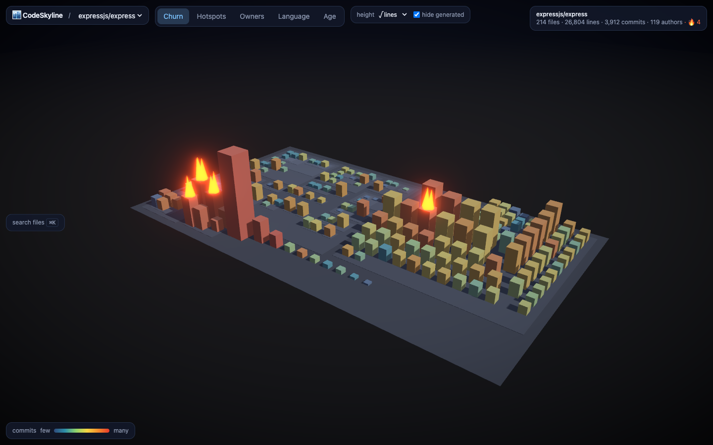

# CodeSkyline

**Turn any GitHub repo into a 3D city you can walk through.**

Paste a repository URL and CodeSkyline renders its codebase as a city: folders are
districts, files are buildings, height is lines of code, color is how often a file
changes, and buildings that *catch fire* are the bug-prone hotspots hiding in your
commit history. Scrub a timeline to watch the city grow over years of commits.



> Status: working end to end locally: analyzer, viewer, time travel, ownership
> views, hosted service (Cloudflare) and the PR Action. Public deployment is next.

## What makes it different

- **Time travel.** a slider replays the whole history on the GPU: buildings rise,
  get demolished and catch fire as the commits roll by.
- **Ownership view.** buildings colored by who really maintains them (knowledge
  decays with a one-year half-life), per-district bus factor, and "ghost town"
  detection for code nobody active still owns.
- **Hotspots that mean something.** recent churn × complexity (after
  Tornhill's *Your Code as a Crime Scene*), [validated on 12 real repos](docs/benchmarks.md):
  the top-20 hotspots catch 70% of the files that get bug fixes in the following
  year, against a 21% base rate.
- **PR mode.** a GitHub Action posts a city diff on every pull request: which
  buildings changed, and whether you just touched something on fire.
- **Shareable.** every view is a URL; every repo gets a README badge that is a
  tiny silhouette of its own skyline.

## PR mode (GitHub Action)

```yaml
- uses: actions/checkout@v4
  with: { fetch-depth: 0 }
- uses: harshitaajoshi/codeskyline/action@v1
```

Every pull request gets a sticky comment: hotspot files touched, districts
with bus factor 1, ownership crossings with suggested reviewers, and ghost-town
files nobody active still owns. Runs entirely in your CI; nothing is uploaded.
See [`action/`](action/README.md).

## Hosted service

`edge/` is a Cloudflare Worker (viewer + API + badges + short links) with the
analyzer running in a scale-to-zero Cloudflare Container. Paste a repo URL,
watch it build with live progress, share `/r/owner/repo?t=0.4&mode=owners`
links, and embed a skyline badge:

```md

```

The badge takes `?theme=light`, `?label=<text>` and `?bare=1` (the silhouette
alone, for embedding in your own layout). Hotspot columns are drawn in orange.

See [`edge/README.md`](edge/README.md) for the one-time deploy steps and the
cost guardrails (monthly job budget, repo size cap, rate limits).

## Repository layout

```
analyzer/   Go: the analysis engine (CLI, hosted worker and GitHub Action share it)
web/        React + Three.js viewer
edge/       Cloudflare Worker: API, job queue, short links, badges
action/     GitHub Action for PR mode
format/     The city document format and golden fixtures
docs/       Architecture, decisions, benchmarks
```

## Analyzer quick start

```sh
cd analyzer
go build -o bin/csky ./cmd/csky
./bin/csky analyze https://github.com/expressjs/express --pretty
# → expressjs__express.city.json
```

Or analyze a local clone: `./bin/csky analyze ~/src/my-project`.

The analyzer never checks out a working tree; it reads history with `git log`
and file contents with `git cat-file`, so untrusted repositories cannot run code
or plant symlinks on the machine doing the analysis.

## Viewer quick start

```sh
pnpm install
pnpm dev:web        # http://localhost:5173, loads the bundled express sample
```

Drop any `*.city.json` produced by `csky` onto the page to render it. Modes:
**Churn · Hotspots · Owners · Language · Age**. Click a building to inspect it
and fly to it; <kbd>⌘K</kbd> jumps to a file by name.

## Development

```sh
cd analyzer && go test ./...          # analyzer
pnpm --filter web test                # viewer unit tests
pnpm --filter web typecheck
node web/scripts/shot.mjs http://localhost:5173 shot.png   # headless screenshot + console
```

## License

MIT
