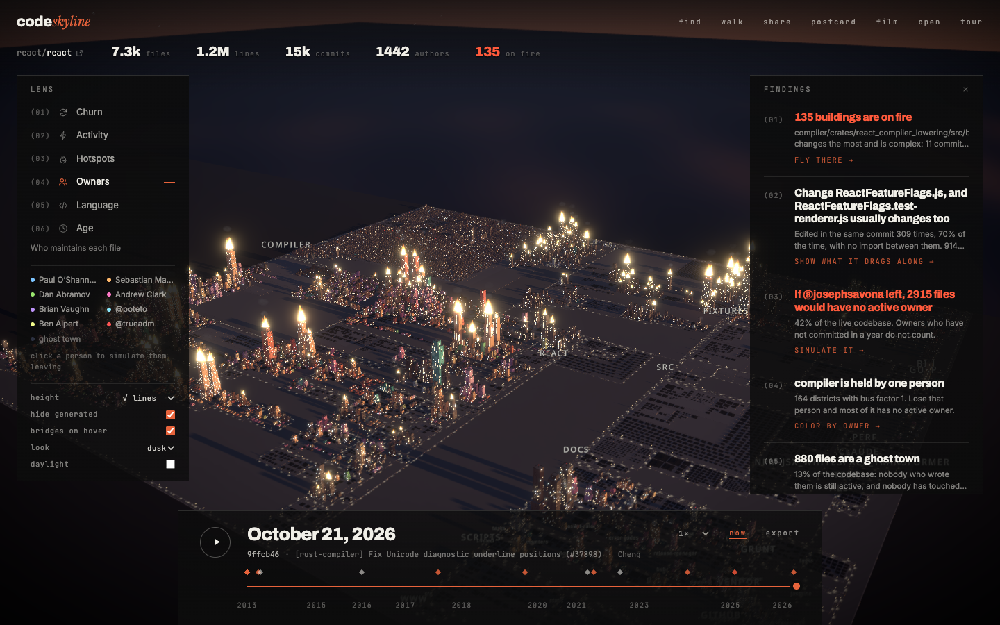
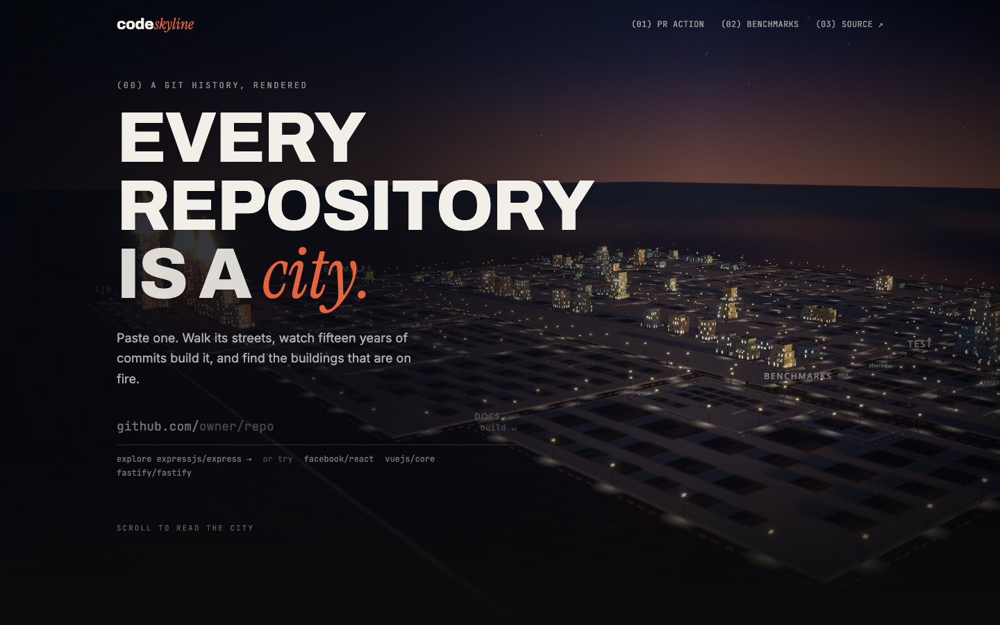

# CodeSkyline

**Every repository is a city.** Paste a GitHub URL and CodeSkyline renders the
codebase as a 3D city built from its commit history: folders are districts,
files are buildings, height is lines of code, and the buildings on fire are the
hotspots where the next bugs will be fixed.

**Try it: [codeskyline.dev](https://codeskyline.dev).** Or take any GitHub URL
and swap the host: [codeskyline.dev/apache/iggy](https://codeskyline.dev/apache/iggy).

[](https://codeskyline.dev/harshitaajoshi/codeskyline)



Everything comes from `git log`. No working tree is checked out, no code is
uploaded anywhere, and the hosted analyzer runs in a scale-to-zero container
that costs nothing while idle.

## What it finds

Open a city and the **Findings** panel reads the history out in plain sentences.
Each one is a button that shows it.

- **Hotspots burn.** Recent churn × complexity (after Tornhill's *Your Code as a
  Crime Scene*). [Validated on twelve repositories](docs/benchmarks.md): the top
  twenty hotspots catch 70% of the files that receive bug fixes in the following
  year, against a 21% base rate. Fire has three levels, and it spreads and dies
  down as you scrub through time.
- **Hidden dependencies.** Files that keep changing in the same commits are
  bridged, even when nothing imports one from the other. Mined with association
  rules over the log (support and confidence), so it sees what a parser cannot.
  Hover or select a building to see what it drags along.
- **If someone left.** In the Owners lens, click a person and every building whose
  only remaining active owner is them goes dark. Knowledge decays with a one-year
  half-life; owners who have not committed in a year do not count.
- **Bus factor and ghost towns.** Per-district truck factor, and files nobody
  active still owns and nobody has touched in a year.
- **The story.** Rewrites, demolitions, bursts of activity, new districts, people
  arriving and leaving: detected from the history and marked on the timeline.


## How it feels

- **Time travel.** Press space and 256 keyframes of the whole history replay on
  the GPU: buildings rise, get demolished and catch fire as the commits roll by.
  Smooth at fifty thousand buildings. Export the replay as a video.
- **Six lenses.** Churn, activity, hotspots, owners, language, age. Plus a diff
  lens when a city is built against a base commit.
- **Walk mode.** Drop to street level and walk the districts with collision.
- **Find anything.** ⌘K jumps to a file; the camera flies there and tags it.
  `?` lists every key.
- **A tour** the first time a city opens (replay it any time), and a landing
  page where the city demonstrates each idea as you scroll.
- **A real city at dusk.** Towers with setbacks and spires, floors and
  storefronts on the facades, sidewalks, lamps, trees, lane markings, traffic
  with headlights, a harbour the skyline reflects in, and fire that lights up
  the buildings around it. Cranes appear on buildings that are growing;
  demolitions leave rubble.
- **Two looks, and daylight.** Dusk (the default) and Noir (black and white,
  the fires are the only colour), each in dusk or daylight. Pick them in the
  lens panel or with `?theme=noir&day=1`; shared links and postcards keep
  them, and your preferences are remembered.
- **Postcard and film.** Save a 2x picture of the city, or run a forty second
  flythrough over its findings.
- **Swap the host.** `github.com/apache/iggy` becomes `codeskyline.dev/apache/iggy`:
  the city opens, or starts building if it has never been built. Deep GitHub
  paths (`/tree/main/src`, `/pull/12`) and a trailing `.git` land on the same city.
- **Shareable.** Every view is a URL (`/owner/repo?t=0.4&mode=owners&f=12`),
  short links that unfurl with a picture of the skyline on Slack, X and
  LinkedIn, and a README badge that is a silhouette of the repo's own skyline
  and says how fresh the city is.
- **Yours stays yours.** The front page lists the cities this browser built,
  with how far each has fallen behind its repository and a rebuild; nobody
  else sees them. A short curated set is featured for first-time visitors.
- **No dead ends.** A city link that is still building shows the live
  progress and opens when it lands; one that was never built offers to build
  it; a bad address, a private repository, a repository over the size cap and
  a spent monthly budget each say so plainly. Phones get the repository's
  skyline and a note that the city wants a desktop.



## PR mode (GitHub Action)

```yaml
- uses: actions/checkout@v4
  with: { fetch-depth: 0 }
- uses: harshitaajoshi/codeskyline/action@v1
```

Every pull request gets a sticky comment with a risk report from the
repository's own history: hotspot files touched, files this PR probably missed
(they usually change together with the ones it did), districts with bus factor
1, ownership crossings with suggested reviewers, and ghost-town files. Runs
entirely in your CI; nothing leaves the runner. See [`action/`](action/README.md).

## Hosted service

`edge/` is a Cloudflare Worker (viewer, API, badges, link previews, short
links) with the analyzer running in a Cloudflare Container that scales to zero.
Paste a repo URL and watch it build with live progress, an estimate from the
repository's size, and git's own clone percentage for the big ones. Cities are
immutable per commit and served pre-gzipped from R2; `/api/repo/owner/name`
says whether a city is behind its repository.

```md
[](https://codeskyline.dev/owner/repo)
```

The badge takes `?theme=light`, `?label=<text>` and `?bare=1` (the silhouette
alone, for your own layout). Hotspot columns are drawn in orange, and the
stats end with how long ago the city was built. Every `/owner/repo` page
carries Open Graph tags and a 1200×630 preview image rendered in the Worker.

Deploy steps and the cost guardrails (monthly job budget, repository size cap,
rate limits) are in [`edge/README.md`](edge/README.md). Budget: the $5 Workers
Paid plan covers it.

## Repository layout

```
analyzer/   Go: the analysis engine (CLI, hosted worker and GitHub Action share it)
web/        React 19 + React Three Fiber viewer
edge/       Cloudflare Worker: API, job queue, Durable Object, R2, D1, badges
action/     GitHub Action for PR mode
format/     The city document format and golden fixtures
docs/       Architecture, benchmarks, images
```

## Analyzer quick start

```sh
cd analyzer
go build -o bin/csky ./cmd/csky
./bin/csky analyze https://github.com/expressjs/express --pretty
# → expressjs__express.city.json
```

Or a local clone: `./bin/csky analyze ~/src/my-project`. Other commands:
`csky pr` writes the pull request risk report, `csky validate` reruns the
hotspot study on any repository.

The analyzer never checks out a working tree; it reads history with
`git log --first-parent --numstat` and file contents with `git cat-file`, so an
untrusted repository cannot run code or plant symlinks on the machine doing the
analysis. Renames are followed, generated and vendored files are classified the
way GitHub Linguist does it, and line counts are checked against HEAD.

## Viewer quick start

```sh
pnpm install
pnpm dev:web        # http://localhost:5173, loads the bundled express sample
pnpm dev:edge       # http://localhost:8787, the hosted API with a local container
```

Drop any `*.city.json` produced by `csky` onto the page to render it. Drag to
orbit, scroll to zoom, space to play, ⌘K (Ctrl+K) to find a file, `d` for
daylight, `?` for every key, Walk to stroll the streets.

## Development

```sh
cd analyzer && go test ./...          # analyzer
pnpm --filter web test                # viewer unit tests
pnpm --filter web typecheck
pnpm --filter edge test               # worker
node web/scripts/shot.mjs http://localhost:5173 shot.png   # headless screenshot on the GPU + console
```

[`docs/architecture.md`](docs/architecture.md) explains the pipeline, the city
format, the layout algorithm and the GPU time travel.

## License

MIT
